# Manual de uso de RadioMaker

> Manual inicial de usuario para RadioMaker y sus complementos RMVoice y RMWave. La interfaz y las funciones pueden cambiar entre versiones

[English version](user-manual.en.md)

## 1. ¿Qué es RadioMaker?

RadioMaker es la aplicación principal de automatización y reproducción. Permite organizar audio en playlists, botoneras Cart, tandas y listas de programación. También incluye el File Manager o Explorador de Archivos, el control de buses de salida y herramientas de audio.

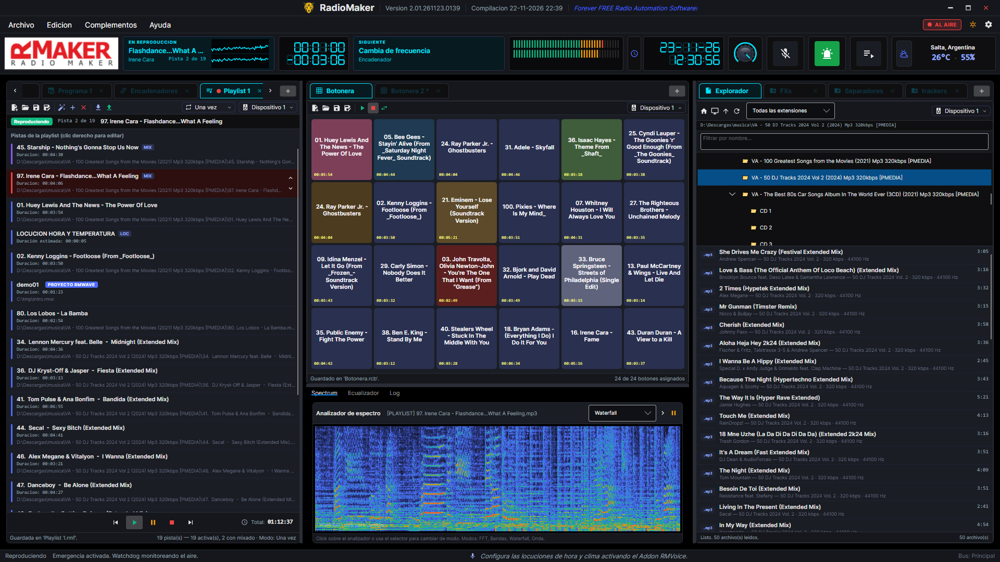

Los complementos incluidos en el paquete amplían sus funciones:

- **RMVoice** administra perfiles de voz y genera locuciones de hora y clima.
- **RMWave** permite editar proyectos multipista `.rmw` y exportar mezclas.

## 2. Primeros pasos

### 2.1 Revisar la salida de audio

1. Abra **Configuración** desde el engranaje de la ventana principal.
2. Entre en **Buses de salida** y configure los dispositivos de audio disponibles.
3. En **Ruteo por módulo**, asigne un bus a cada módulo que tenga selector: Cart, Playlist, Programados y File Manager.
4. Compruebe el bus actual en la barra inferior de RadioMaker.

Las tandas y los Encadenadores no tienen un selector de bus propio. Heredan el ruteo del Scheduler (programados) o de la playlist donde se están reproduciendo. El volumen general se controla desde el panel superior.

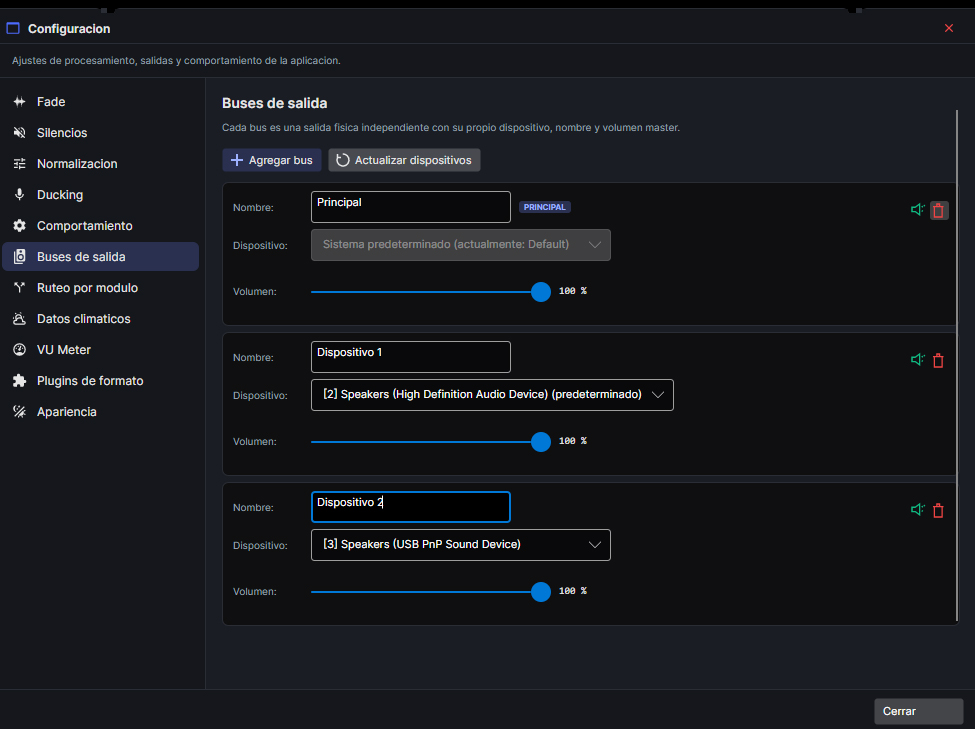
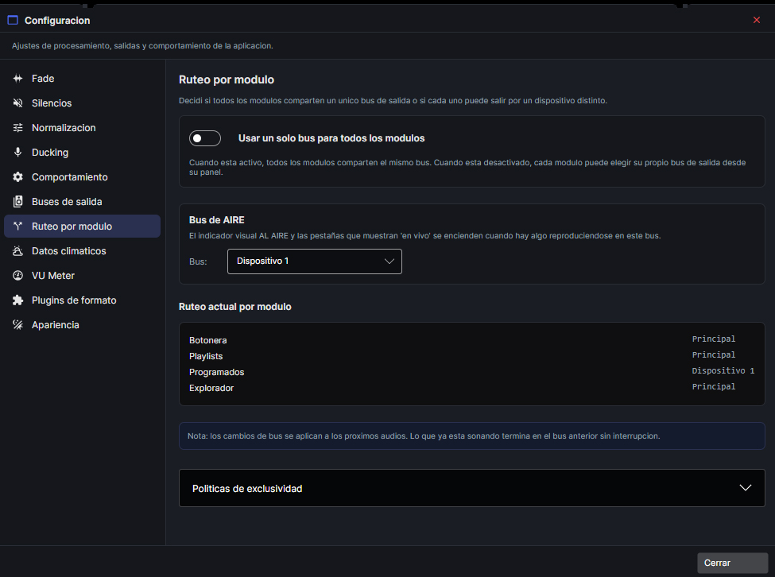
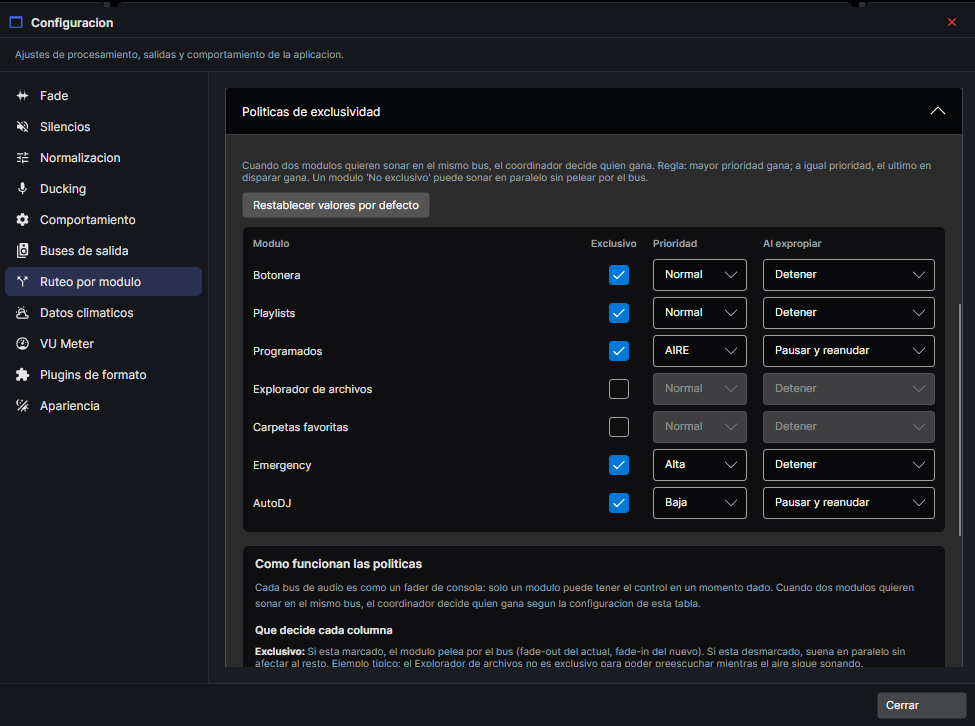

### 2.2 Familiarizarse con la ventana principal

La ventana se organiza en estas áreas:

- **Barra superior:** menús Archivo, Edición, Playlists, Configuración, Complementos y Ayuda; indicador de emisión y cambio de tema.
- **Panel informativo superior:** contenido en reproducción, siguiente contenido, tiempo, hora, control de volumen, locuciones, Ducking y acceso a emergencia.
- **Columna izquierda:** Eventos y pestañas de trabajo, como Programados, Tandas, Playlists, Encadenadores y Notas.
- **Columna central:** botoneras Cart y pestañas de trabajo. En la parte inferior están Spectrum, Ecualizador y Log.
- **Columna derecha:** File Manager (explorador de archivos) y carpetas favoritas.
- **Barra inferior:** estado de reproducción, mensajes, tips y bus seleccionado.

El contenido exacto de cada columna puede variar según las pestañas abiertas.

### 2.3 Pestañas de trabajo

- Use el botón **+** de la barra de pestañas para crear una pestaña del tipo disponible en esa columna.
- Haga doble clic en el nombre de una pestaña para renombrarla.
- Use la **X** para cerrar pestañas que se puedan cerrar.
- Arrastre archivos desde File Manager hasta una pestaña compatible para agregarlos.
- Cada editor tiene controles propios para crear, abrir y guardar sus archivos en sus respectivos formatos.

RadioMaker guarda el espacio de trabajo para recuperar pestañas y distribución en el próximo inicio. Los archivos de audio usados por playlists, tandas y otros proyectos se conservan en sus ubicaciones originales; mantenga accesibles esas rutas.

## 3. File Manager y carpetas favoritas

File Manager permite navegar por carpetas, filtrar por tipo, buscar por nombre y preescuchar archivos. El bus de preescucha se configura por separado desde el ruteo del módulo.

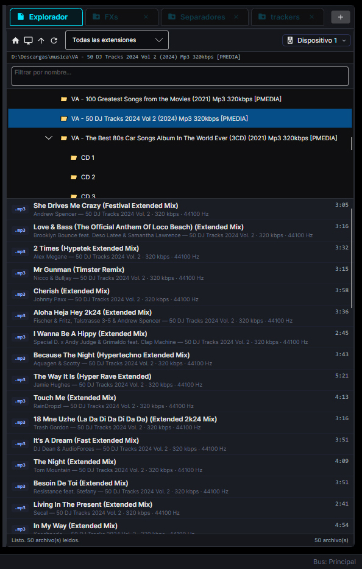

Para trabajar con un archivo:

1. Navegue hasta la carpeta o use los accesos de carpeta personal, Escritorio y carpeta superior.
2. Seleccione el filtro deseado y escriba parte del nombre en el campo de búsqueda.
3. Use la preescucha para comprobar el audio. Puede detenerla desde el botón correspondiente.
4. Arrastre el archivo a una playlist, una tanda, un Cart u otra pestaña compatible.

El menú contextual de archivos permite, según el tipo de archivo, editar tags, abrir un proyecto en RMWave o cargar un proyecto nativo en una pestaña. También se pueden agregar carpetas a Favoritos y abrirlas desde sus pestañas dedicadas.

## 4. Playlists

Una playlist reúne pistas de audio y, si RMVoice está disponible, comandos de locución. Se guarda en un archivo **`.rmf`**.

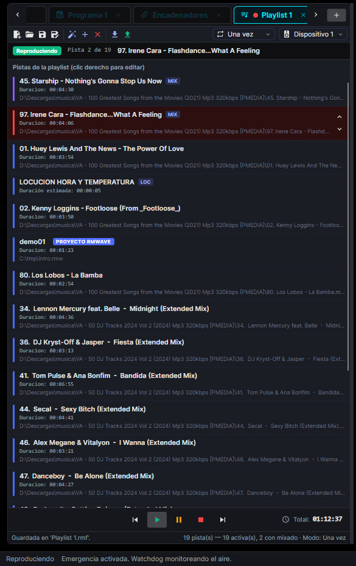

### Crear y editar

1. Cree una pestaña **Playlist** con el botón **+**, o abra un `.rmf` existente.
2. Agregue pistas con el botón **+** o arrastrándolas desde File Manager.
3. Reordene las pistas con los controles de subir/bajar. Desactive una pista con su control de habilitación si no quiere incluirla en la reproducción actual.
4. Abra **Editar** desde el menú contextual para cambiar las propiedades de la pista. Puede ajustar volumen, fades, mixado y, para comandos de locución, el tipo de anuncio.
5. Guarde con los botones de la barra de herramientas. Use **Guardar como** para crear otro archivo.

La playlist permite los modos **Una vez**, **Repetir** y **Aleatorio**. Los controles de reproducción incluyen pista anterior, reproducir, reanudar, pausar, detener y pista siguiente. La pausa de una locución RMVoice la detiene; al reanudar, la locución comienza nuevamente.

Los fades y crossfades se configuran desde **Configuración > Fade**. Las locuciones de RMVoice se insertan como comandos, no como archivos de audio ordinarios.

También se pueden importar playlists **M3U/M3U8** y **PLS**, y exportar la lista a esos formatos. Estos formatos externos pueden no conservar todas las propiedades específicas de RadioMaker.

Desde **Edición > Playlists > Generador Automático** se puede crear una playlist a partir de una carpeta y sus opciones. El generador también permite guardar y cargar presets de configuración.

## 5. Programados y Eventos

Una pestaña **Programados** contiene elementos que el Scheduler dispara según los días y horarios configurados. Cada lista se guarda en un archivo **`.rms`** y tiene un switch para activarla o desactivarla. Una lista desactivada no se dispara.

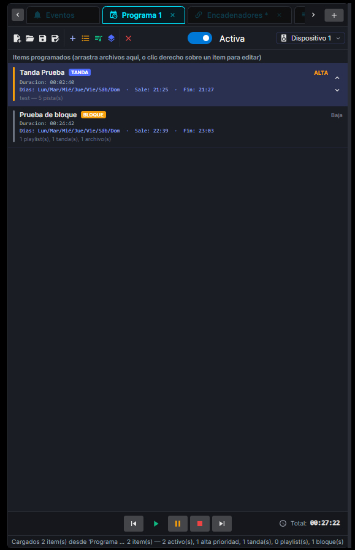
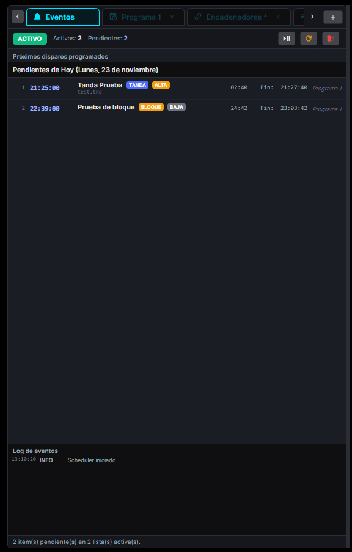

### Tipos de elemento que pueden ser contenidos en un Programado

- **Archivo:** reproduce un archivo de audio suelto.
- **Tanda:** reproduce una tanda `.tnd`.
- **Playlist:** reproduce una playlist `.rmf`.
- **Bloque:** es un grupo que encadena playlists, tandas y archivos en el orden definido para luego reproducirla.

Para programar un elemento, agréguelo a la lista, abra su editor y configure el contenido, los días, la hora, la prioridad y las demás opciones disponibles. Guarde el `.rms` y active la lista cuando quiera que el Scheduler la procese. Use el selector de bus de la pestaña para elegir la salida de Programados.

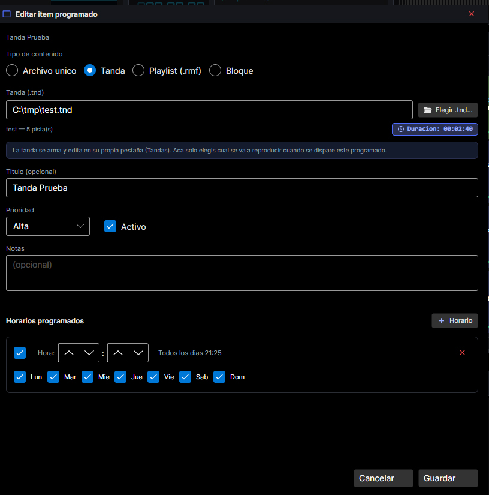

El panel **Eventos** muestra los próximos disparos de las listas activas, con su horario y duración; también incluye el estado y el registro del Scheduler.

Los controles de la pestaña Programados permiten iniciar o detener la reproducción de la lista y avanzar, pausar o reanudar elementos. Una programación de prioridad **Alta** puede adelantarse a una playlist manual; al terminar, la playlist continúa desde donde quedó.

## 6. Tandas

Una tanda es una secuencia ordenada de pistas que se reproduce como una unidad. Se edita en una pestaña **Tanda** y se guarda en un archivo **`.tnd`**.

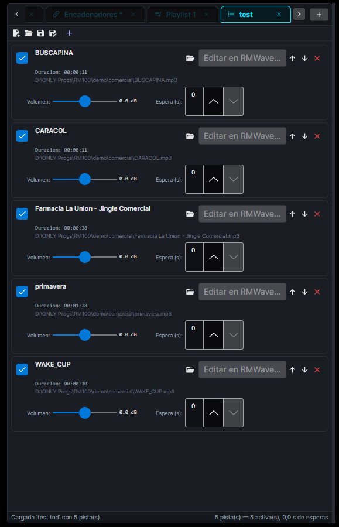

1. Cree una tanda o abra un `.tnd` existente.
2. Agregue archivos de audio y ordénelos con los controles de cada pista.
3. Use la casilla de habilitación para incluir o excluir una pista.
4. Ajuste el volumen individual y la espera entre pistas si hace falta.
5. Guarde el archivo y agréguelo a una lista de Programados.

La pestaña de edición de tandas no tiene controles de reproducción. La tanda sale a través del ruteo heredado del Scheduler y no se interrumpe para insertar Encadenadores.

## 7. Encadenadores

Los Encadenadores intercalan audios entre pistas de una playlist o una secuencia del Scheduler. No se aplican a Cart ni a tandas. Se configuran en una pestaña propia y se guardan en un archivo **`.rme`**.

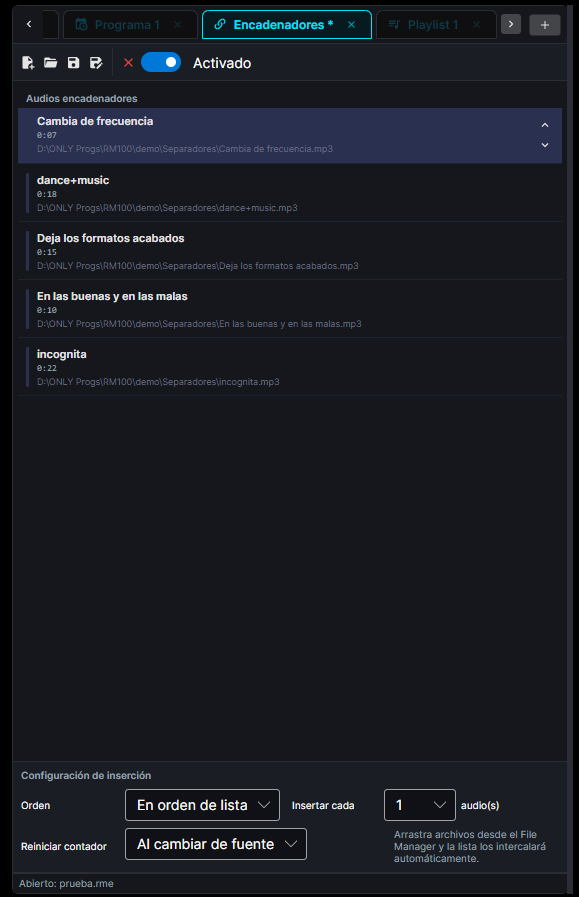

1. Cree una pestaña Encadenadores en la columna izquierda o central.
2. Arrastre audios desde File Manager y ordénelos en la lista.
3. Active la pestaña con su switch. Solo puede haber una lista de Encadenadores activa; al activar otra, la anterior se desactiva.
4. Elija reproducción en orden o aleatoria.
5. Configure cada cuántos audios insertar un Encadenador.
6. Decida si el contador se reinicia al cambiar de fuente, por ejemplo al pasar de playlist a Programados.
7. Guarde la configuración en `.rme`.

Los Encadenadores se reproducen sin fades propios y respetan el volumen global. Si los fades están habilitados, se acoplan a las transiciones de los audios de playlist o Scheduler: el fade de salida del audio actual y el fade de entrada del siguiente se aplican según la duración configurada. El ruteo se hereda de la fuente que los inserta.

La pestaña solo configura la lista; no incluye botones de reproducción.

## 8. Carts

Cart es una botonera para disparar audios directamente. Cada botón puede tener un archivo asignado, etiqueta y atajo de teclado. La botonera se guarda como **`.rcb`**.

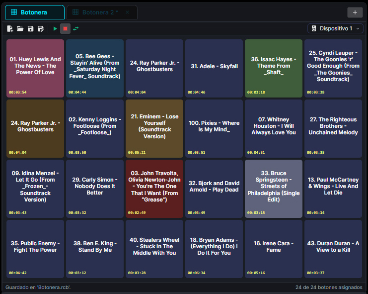

- Use **Editar** en un botón para asignar o cambiar el archivo y sus opciones.
- Seleccione un botón y use **Reproducir** para lanzarlo.
- Use **Detener todos** para detener los audios disparados desde la botonera.
- Active o desactive el crossfade entre Carts desde la barra de herramientas o desde configuracion.
- Elija la salida desde el selector de bus del Cart.
- Haga clic derecho en un botón para editarlo, cambiar sus tags, abrir su proyecto en RMWave, reproducirlo, detenerlo o limpiar su asignación.

Puede mantener más de una botonera abierta en pestañas. Los Carts no reciben inserciones de Encadenadores.

## 9. Spectrum, VU y procesamiento de audio

En el panel central inferior:

- **Spectrum** ofrece vistas de FFT, bandas, waterfall y forma de onda; haga clic en el visualizador para cambiar de modo.
- **Ecualizador** permite ajustar el EQ de RadioMaker para archivos de audio comunes.
- **Log** muestra mensajes de reproducción y del sistema.

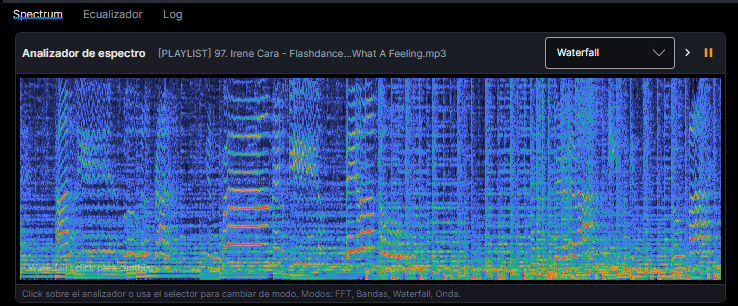
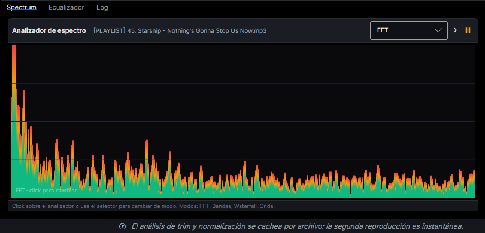
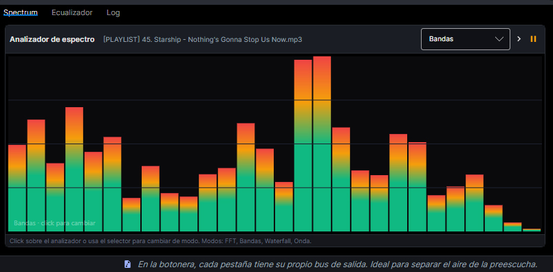
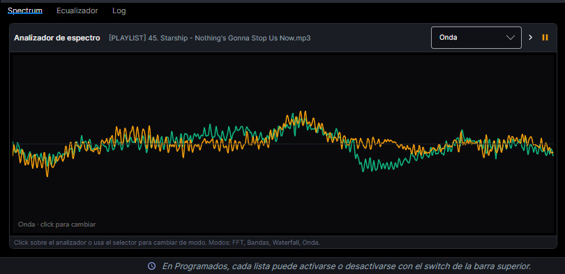

El panel superior muestra el audio actual y el siguiente. El mini visualizador y el VU siguen la fuente activa, incluidas las locuciones RMVoice cuando hay un stream disponible.

Abra **Configuración** para ajustar:

- **Fade:** fades de entrada/salida y crossfade.
- **Silencios:** opciones para detección/recorte de silencios en los casos compatibles.
- **Normalización:** tratamiento de nivel en los casos compatibles.
- **Ducking:** atenuación automática del audio cuando se detecta señal en el micrófono.
- **Buses de salida:** dispositivos y buses disponibles.
- **Ruteo por módulo:** bus para Cart, Playlist, Programados y File Manager.
- **VU Meter:** apariencia y comportamiento del medidor.
- **Plugins de formato:** extensiones de audio disponibles según el paquete.
- **Apariencia:** opciones visuales.
- **Datos climáticos:** ajustes asociados a las locuciones del clima.
- **Comportamiento:** políticas de coexistencia entre módulos cuando dos fuentes quieren usar recursos de reproducción al mismo tiempo.

Los cambios de configuración se aplican en vivo cuando corresponda. La configuración de buses se guarda desde su sección.

### Tags de audio y registro

Use **Edición > Editar tags** o el menú contextual de un archivo para modificar sus metadatos cuando el formato lo permita. Los proyectos `.rmw` se abren en RMWave en vez de tratarse como archivos con tags de audio.

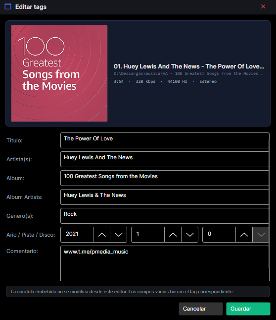

El panel **Log** muestra el registro de reproducción. Desde sus opciones de exportación se puede guardar el registro en uno de los formatos ofrecidos por la aplicación.

### Notas

Use **Archivo > Nuevo > Nota** para abrir un editor de texto plano. Las notas se guardan automáticamente como borrador mientras escribe y se pueden abrir o guardar como archivos **`.txt`**. Si todavía no las guardó en una ruta elegida, el borrador permanece asociado a la pestaña del espacio de trabajo.

## 10. RMVoice: locuciones de hora y clima

RMVoice proporciona los audios y perfiles que RadioMaker usa para anunciar la hora y el clima. Se puede abrir desde **Complementos > RM Voice** o desde las opciones del panel superior.

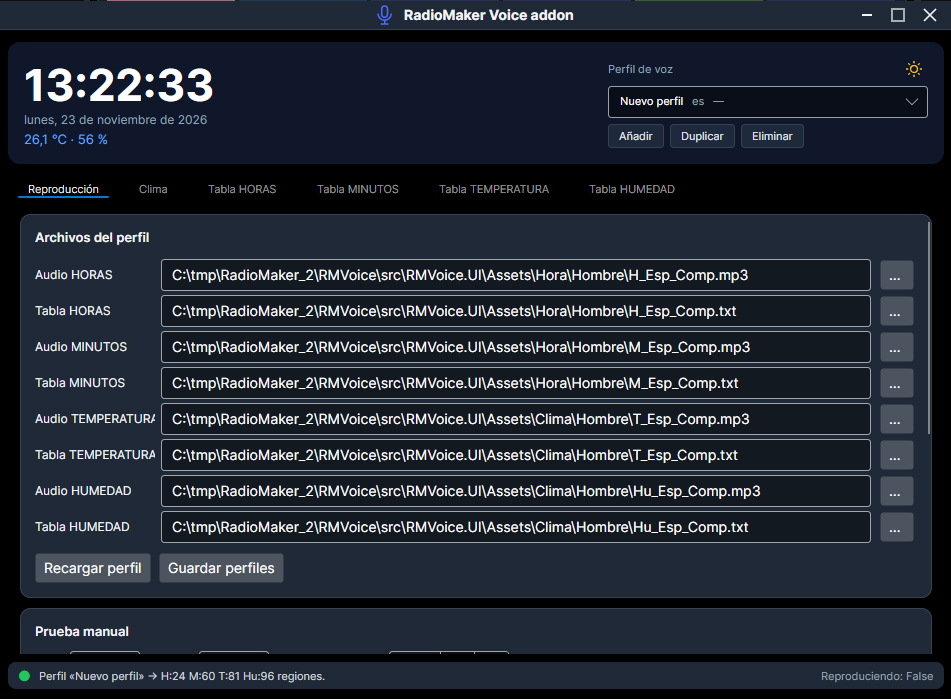

### Configurar un perfil

1. Abra RMVoice y seleccione un perfil de voz.
2. En **Reproducción**, asigne el audio y la tabla correspondientes a horas, minutos, temperatura y humedad.
3. Use **Recargar perfil** para volver a cargar los recursos y **Guardar perfiles** para guardar los cambios.
4. Pruebe la configuración con **Reproducir selección** o con los botones de anuncio rápido.
5. Configure ubicación y actualización del clima desde las opciones de clima.

RadioMaker ofrece botones rápidos para anunciar hora y clima. También se pueden añadir comandos de locución a pistas de playlist y a secuencias compatibles del Scheduler. Si RMVoice no está disponible o el perfil no tiene sus recursos configurados, la locución no podrá reproducirse.

## 11. RMWave: edición y exportación de audio

RMWave es un editor multipista. Se abre desde **Complementos > RM Wave**, desde el menú contextual de algunos archivos o desde botones **Editar en RMWave**.

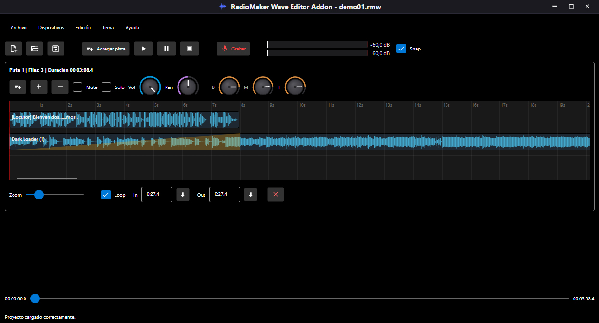

### Crear un proyecto

1. Use **Archivo > Nuevo** o el botón de proyecto nuevo.
2. Agregue una pista y coloque clips de audio en la línea de tiempo.
3. Seleccione un clip para editar inicio, offset, duración, ganancia, fade in y fade out.
4. Use los comandos de edición para duplicar, cortar en el cursor, eliminar o normalizar clips.
5. Guarde el proyecto como **`.rmw`**.

El proyecto conserva referencias a los archivos fuente; no mueva ni elimine esos audios si quiere volver a abrirlo correctamente.

### Reproducir, grabar y exportar

- Use **Reproducir**, **Pausa** y **Detener** en la barra de transporte. La barra espaciadora reproduce/pausa.
- Configure el dispositivo desde **Dispositivos**.
- Para grabar, use **Grabar audio** y seleccione la entrada y el destino en el diálogo.
- Puede agregar, administrar e importar marcadores de regiones.
- Use **Exportar mezcla** para renderizar el proyecto completo y **Exportar selección** para renderizar un rango seleccionado.

RMWave puede generar `.rmw` para usarlos como fuente dentro de RadioMaker. La reproducción de esos proyectos en RadioMaker utiliza el motor de RMWave integrado.

Atajos de teclado principales de RMWave:

| Atajo | Acción |
| --- | --- |
| `Ctrl+N` | Nuevo proyecto |
| `Ctrl+O` | Abrir proyecto |
| `Ctrl+S` | Guardar proyecto |
| `Ctrl+E` | Exportar mezcla |
| `Ctrl+Shift+E` | Exportar selección |
| `Ctrl+D` | Duplicar clip seleccionado |
| `Ctrl+B` | Cortar clip en el cursor |
| `Ctrl+R` | Abrir grabación de audio |
| `Espacio` | Reproducir o pausar |
| `Delete` | Eliminar clip o rango seleccionado |

## 12. Emergencia

El control de emergencia se configura desde **Configuración > Emergencia**. Configure la fuente o playlist prevista y sus opciones antes de utilizarlo al aire. El botón de emergencia inicia el modo configurado; el banner superior indica que está activo y ofrece **Detener emergencia**.

Realice una prueba controlada fuera del aire para verificar la fuente, el volumen y el bus antes de depender de esta función en una situación real.

## 13. Formatos de RadioMaker

| Extensión | Contenido |
| --- | --- |
| `.rmf` | Playlist |
| `.rms` | Lista de Programados |
| `.tnd` | Tanda |
| `.rme` | Lista de Encadenadores |
| `.rcb` | Botonera Cart |
| `.rmw` | Proyecto multipista de RMWave |
| `.txt` | Nota de texto plano |

El generador de playlists utiliza presets **`.rpg`**; estos guardan opciones del generador y no son playlists.

Los formatos nativos de RadioMaker guardan configuración y rutas de medios. Para trasladar proyectos a otra computadora, copie también los archivos de audio referenciados o asegúrese de que estén disponibles en las mismas rutas.

## 14. Solución de problemas

### No se escucha audio

1. Compruebe que el dispositivo esté disponible en **Buses de salida**.
2. Revise el bus asignado al módulo que reproduce el audio.
3. Compruebe el volumen global y el volumen del elemento.
4. Verifique que el archivo exista y que el formato esté soportado por los plugins disponibles.

### Una locución no suena

1. Compruebe que RMVoice esté disponible desde el panel o el menú Complementos.
2. Revise que exista un perfil seleccionado y que sus audios y tablas estén configurados.
3. Compruebe ubicación y datos climáticos para los anuncios de clima.
4. Pruebe un anuncio manual desde RMVoice.

### Un proyecto no encuentra sus audios

Los proyectos guardan rutas a medios externos. Restaure los audios a su ubicación original o vuelva a asignar los archivos faltantes desde el editor correspondiente.

### El audio sale por otro dispositivo

Revise **Configuración > Ruteo por módulo** y el selector de bus de la pestaña. Recuerde que Tandas y Encadenadores heredan el ruteo de Programados o de la playlist que los reproduce.

## 15. Glosario

- **Bus de salida:** ruta de audio asociada a un dispositivo de reproducción.
- **Playlist:** secuencia de pistas que puede ejecutarse manualmente.
- **Programado/Scheduler:** reproducción automatizada por día y horario.
- **Tanda:** secuencia de audios que se reproduce como unidad.
- **Cart:** botón de disparo directo de audio.
- **Encadenador:** audio insertado entre pistas de playlists o Programados.
- **Mixado:** audio o locución asociado a una pista de playlist según su configuración.
- **Fade/Crossfade:** transición gradual entre audios.
