# RadioMaker User Manual

> Initial user manual for RadioMaker and its RMVoice and RMWave add-ons. The interface and features may change between releases.

[Versión en español](manual-usuario.md) · **English**

## 1. What is RadioMaker?

RadioMaker is the main automation and playback application. It lets you organize audio into playlists, Cart boards, sequences, and scheduled lists. It also includes the File Manager, output-bus controls, and audio tools.

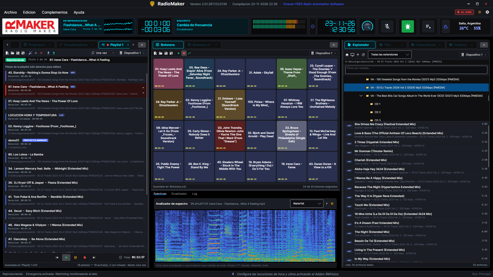

The add-ons included in the package extend its features:

- **RMVoice** manages voice profiles and creates time and weather announcements.
- **RMWave** edits multitrack `.rmw` projects and exports mixes.

## 2. Getting started

### 2.1 Check the audio output

1. Open **Settings** from the gear icon in the main window.
2. Open **Output Buses** and configure the available audio devices.
3. Under **Module Routing**, assign a bus to each module that has a selector: Cart, Playlist, Scheduled, and File Manager.
4. Check the current bus in RadioMaker's bottom bar.

Sequences and Chainers do not have their own bus selector. They inherit routing from the Scheduler (Scheduled) or the playlist that is playing them. Overall volume is controlled from the top panel.

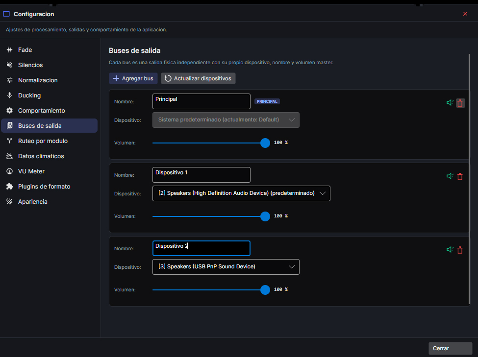
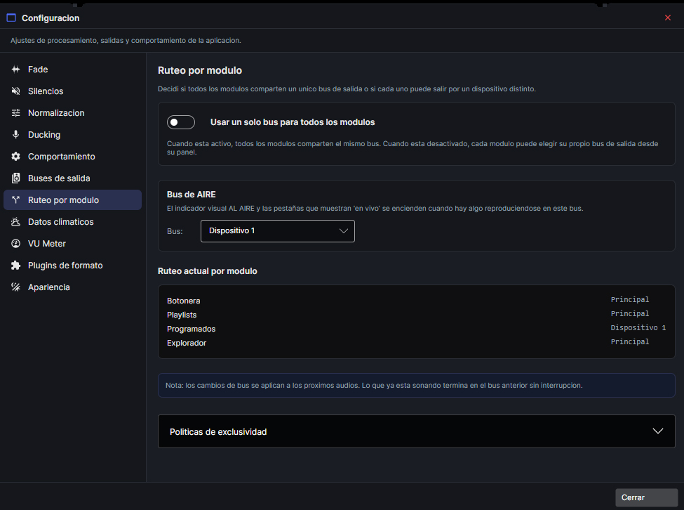
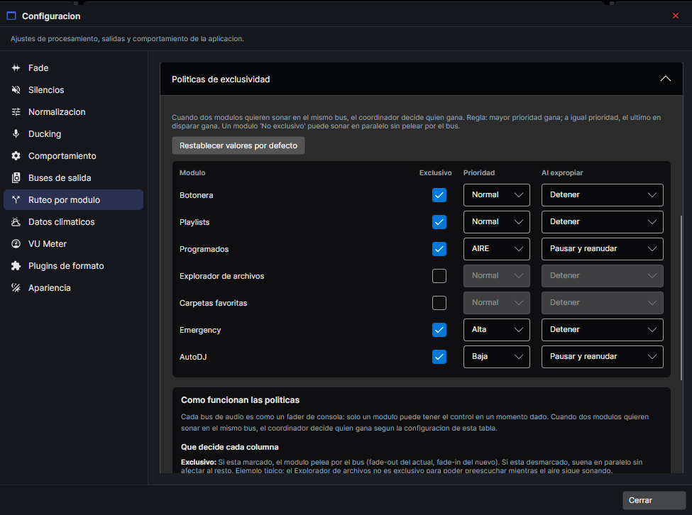

### 2.2 Get familiar with the main window

The window is organized into these areas:

- **Top bar:** File, Edit, Playlists, Settings, Add-ons, and Help menus; on-air indicator and theme selector.
- **Top information panel:** current and next content, time, clock, volume control, voice announcements, Ducking, and Emergency access.
- **Left column:** Events and work tabs such as Scheduled, Sequences, Playlists, Chainers, and Notes.
- **Center column:** Cart boards and work tabs. Spectrum, Equalizer, and Log are at the bottom.
- **Right column:** File Manager and favorite folders.
- **Bottom bar:** playback status, messages, tips, and selected bus.

The exact contents of each column may vary depending on the open tabs.

### 2.3 Work tabs

- Use the **+** button on a tab bar to create a tab type available in that column.
- Double-click a tab name to rename it.
- Use **X** to close tabs that can be closed.
- Drag files from File Manager to a compatible tab to add them.
- Each editor has its own controls for creating, opening, and saving files in the corresponding formats.

RadioMaker saves the workspace so it can restore the tabs and layout at the next startup. Audio files used by playlists, sequences, and other projects remain at their original locations; make sure those paths stay available.

## 3. File Manager and favorite folders

File Manager lets you browse folders, filter by type, search by name, and preview files. The preview bus is configured separately from module routing.

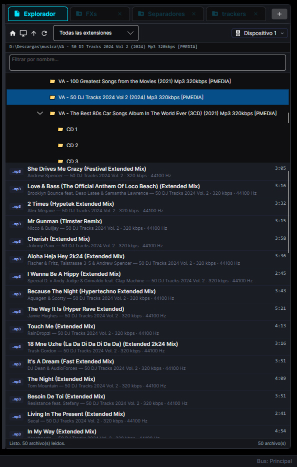

To work with a file:

1. Browse to the folder or use the shortcuts for your personal folder, Desktop, and parent folder.
2. Select the desired filter and enter part of the name in the search field.
3. Preview the audio. Stop it with the corresponding button.
4. Drag the file to a playlist, sequence, Cart, or another compatible tab.

Depending on the file type, the context menu lets you edit tags, open a project in RMWave, or load a native project into a tab. You can also add folders to Favorites and open them from their dedicated tabs.

## 4. Playlists

A playlist contains audio tracks and, when RMVoice is available, voice-announcement commands. It is saved as a **`.rmf`** file.

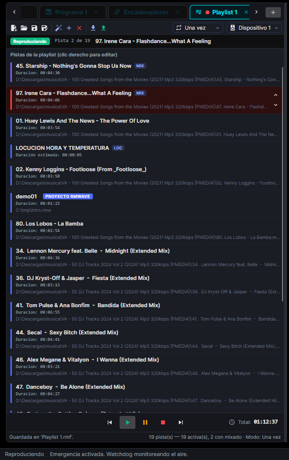

### Create and edit

1. Create a **Playlist** tab with **+**, or open an existing `.rmf` file.
2. Add tracks with **+** or by dragging them from File Manager.
3. Reorder tracks with the move-up/move-down controls. Disable a track with its enable control if you do not want it included in the current playback.
4. Choose **Edit** from the context menu to change track properties. You can adjust volume, fades, mixing, and the announcement type for voice commands.
5. Save with the toolbar buttons. Use **Save As** to create another file.

Playlists support **Once**, **Repeat**, and **Shuffle** modes. Playback controls include previous track, play, resume, pause, stop, and next track. Pausing an RMVoice announcement stops it; when resumed, the announcement starts again from the beginning.

Fades and crossfades are configured under **Settings > Fade**. RMVoice announcements are inserted as commands, not as ordinary audio files.

You can also import **M3U/M3U8** and **PLS** playlists and export a list to these formats. These external formats may not preserve all RadioMaker-specific properties.

Use **Edit > Playlists > Automatic Generator** to create a playlist from a folder and its options. The generator also lets you save and load configuration presets.

## 5. Scheduled and Events

A **Scheduled** tab contains items that the Scheduler triggers according to configured days and times. Each list is saved as a **`.rms`** file and has a switch to enable or disable it. A disabled list will not trigger.

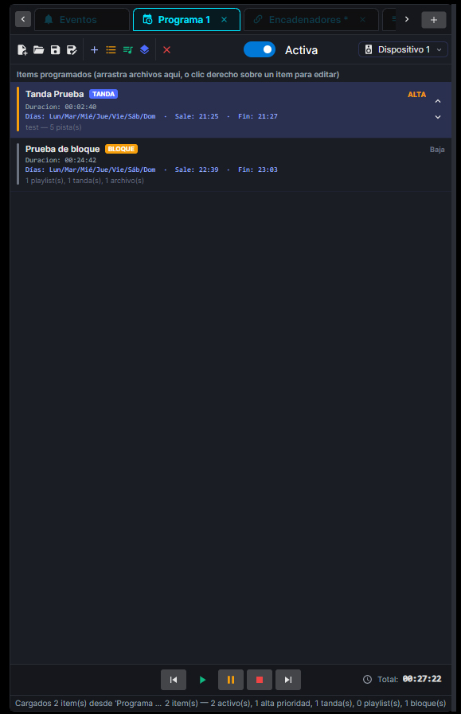
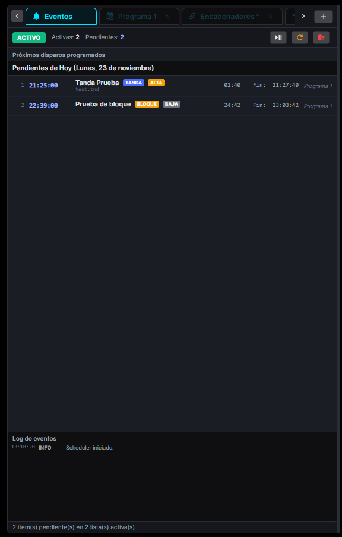

### Item types that can be scheduled

- **File:** plays a single audio file.
- **Sequence:** plays a `.tnd` sequence.
- **Playlist:** plays a `.rmf` playlist.
- **Block:** a group that chains playlists, sequences, and files in the order you define, then plays them.

To schedule an item, add it to the list, open its editor, and configure the content, days, time, priority, and other available options. Save the `.rms` file and enable the list when you want the Scheduler to process it. Use the tab's bus selector to choose the Scheduled output.

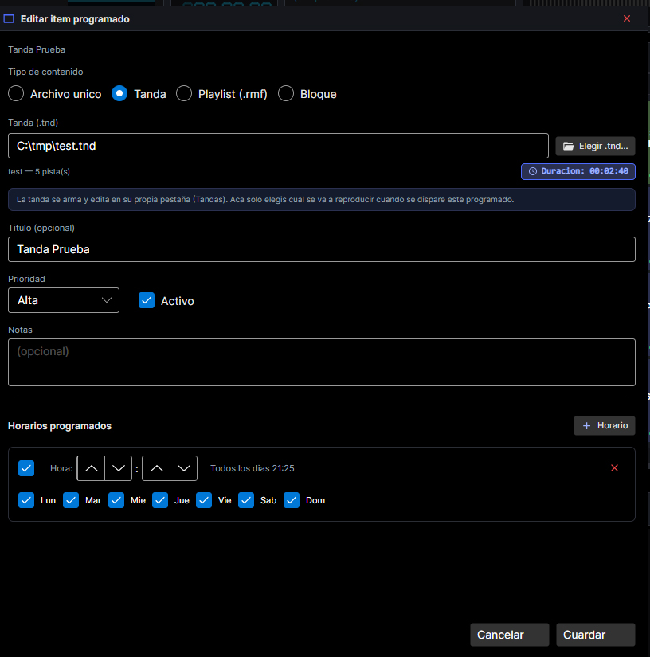

The **Events** panel shows upcoming triggers from enabled lists, including their times and durations. It also shows Scheduler status and logs.

Scheduled tab controls let you start or stop list playback and move between, pause, or resume items. A **High** priority scheduled item can take precedence over a manually playing playlist; when it finishes, the playlist continues from where it stopped.

## 6. Sequences

A sequence is an ordered set of tracks that plays as a unit. Edit it in a **Sequence** tab and save it as a **`.tnd`** file.

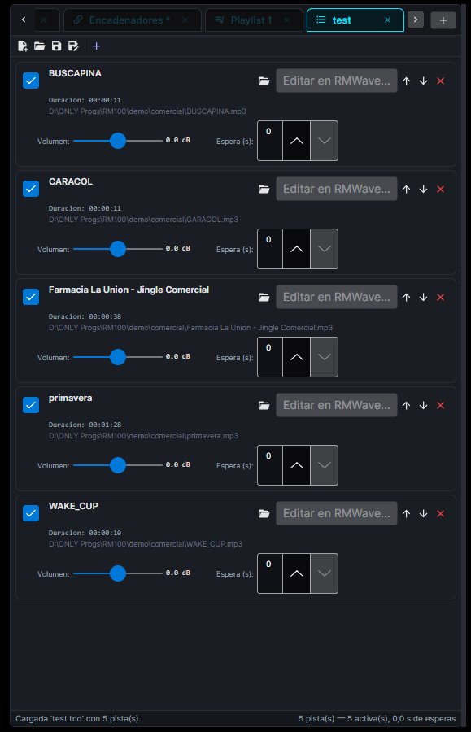

1. Create a sequence or open an existing `.tnd` file.
2. Add audio files and order them with each track's controls.
3. Use the enable checkbox to include or exclude a track.
4. Adjust individual volume and the delay between tracks if needed.
5. Save the file and add it to a Scheduled list.

The sequence editor has no playback controls. A sequence uses routing inherited from the Scheduler and is not interrupted to insert Chainers.

## 7. Chainers

Chainers insert audio between tracks in a playlist or a Scheduler sequence. They do not apply to Cart or sequences. Configure them in their own tab and save them in a **`.rme`** file.

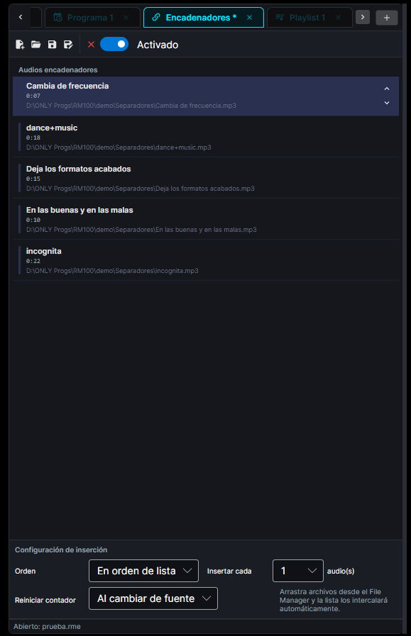

1. Create a Chainers tab in the left or center column.
2. Drag audio from File Manager and order it in the list.
3. Enable the tab with its switch. Only one Chainer list can be active; enabling another disables the previous one.
4. Choose sequential or random playback.
5. Set how many audio tracks play between Chainers.
6. Choose whether the counter resets when the source changes, for example when switching from a playlist to Scheduled playback.
7. Save the configuration as `.rme`.

Chainers play without their own fades and respect global volume. When fades are enabled, they fit into playlist or Scheduler transitions: the current audio fades out and the next track fades in according to the configured duration. Routing is inherited from the source that inserts them.

The tab only configures the list; it has no playback buttons.

## 8. Carts

Cart is a soundboard for triggering audio directly. Each button can have an assigned file, label, and keyboard shortcut. The board is saved as **`.rcb`**.

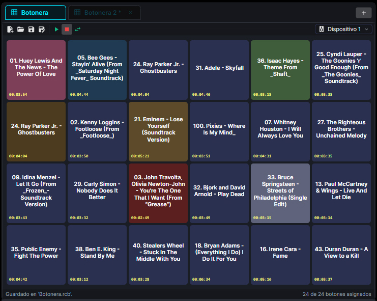

- Choose **Edit** on a button to assign or change its file and options.
- Select a button and choose **Play** to trigger it.
- Use **Stop All** to stop audio started from the board.
- Enable or disable crossfade between Carts from the toolbar or Settings.
- Choose the output using the Cart bus selector.
- Right-click a button to edit it, edit its tags, open its project in RMWave, play it, stop it, or clear its assignment.

You can keep more than one Cart board open in tabs. Chainers are not inserted into Cart playback.

## 9. Spectrum, VU, and audio processing

In the lower center panel:

- **Spectrum** offers FFT, bands, waterfall, and waveform views. Click the visualizer to change modes.
- **Equalizer** adjusts RadioMaker's EQ for common audio files.
- **Log** displays playback and system messages.

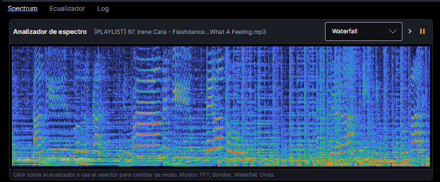
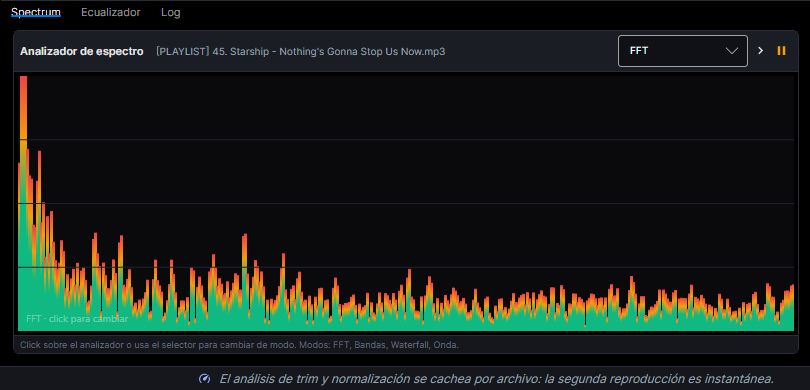
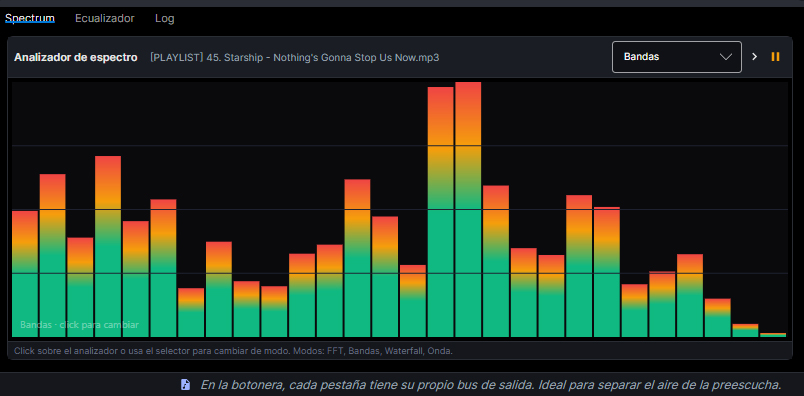
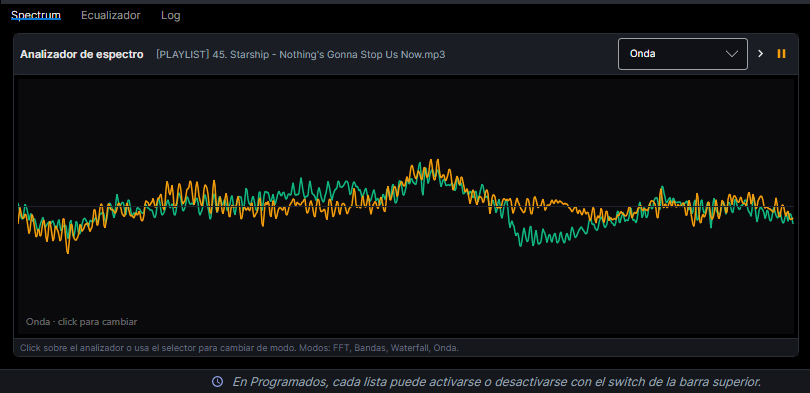

The top panel shows the current and next audio. The mini visualizer and VU meter follow the active source, including RMVoice announcements when a stream is available.

Open **Settings** to adjust:

- **Fade:** fade-in/out and crossfade.
- **Silence:** silence detection/trimming options where supported.
- **Normalization:** level processing where supported.
- **Ducking:** automatic audio attenuation when microphone signal is detected.
- **Output Buses:** available devices and buses.
- **Module Routing:** buses for Cart, Playlist, Scheduled, and File Manager.
- **VU Meter:** meter appearance and behavior.
- **Format Plugins:** audio extensions available in the package.
- **Appearance:** visual options.
- **Weather Data:** settings associated with weather announcements.
- **Behavior:** coexistence policies for situations where two sources compete for playback resources.

Settings take effect immediately where applicable. Bus configuration is saved from its section.

### Audio tags and logging

Use **Edit > Edit Tags** or a file's context menu to change metadata when the format allows it. `.rmw` projects open in RMWave rather than being treated as audio files with tags.

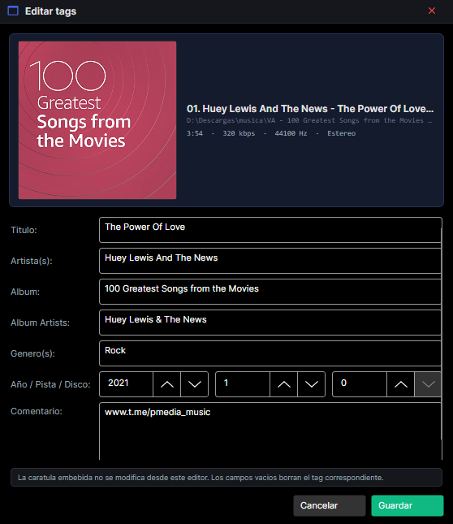

The **Log** panel displays playback records. Its export options let you save the log in one of the formats offered by the application.

### Notes

Use **File > New > Note** to open a plain-text editor. Notes are automatically saved as drafts while you type and can be opened or saved as **`.txt`** files. Until you save to a chosen location, the draft remains associated with the workspace tab.

## 10. RMVoice: time and weather announcements

RMVoice provides the audio and profiles RadioMaker uses to announce the time and weather. Open it from **Add-ons > RM Voice** or from the options in the top panel.

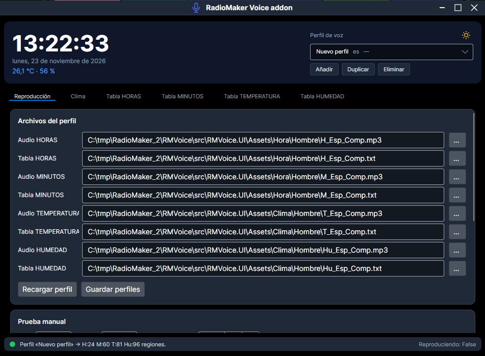

### Configure a profile

1. Open RMVoice and select a voice profile.
2. Under **Playback**, assign the audio and corresponding tables for hours, minutes, temperature, and humidity.
3. Use **Reload Profile** to reload the resources and **Save Profiles** to save changes.
4. Test the setup with **Play Selection** or the quick-announcement buttons.
5. Configure the location and weather updates in the weather options.

RadioMaker provides quick buttons to announce the time and weather. Voice commands can also be added to playlist tracks and compatible Scheduler sequences. If RMVoice is unavailable or the profile does not have its resources configured, the announcement cannot play.

## 11. RMWave: audio editing and export

RMWave is a multitrack editor. Open it from **Add-ons > RM Wave**, a file's context menu, or an **Edit in RMWave** button.

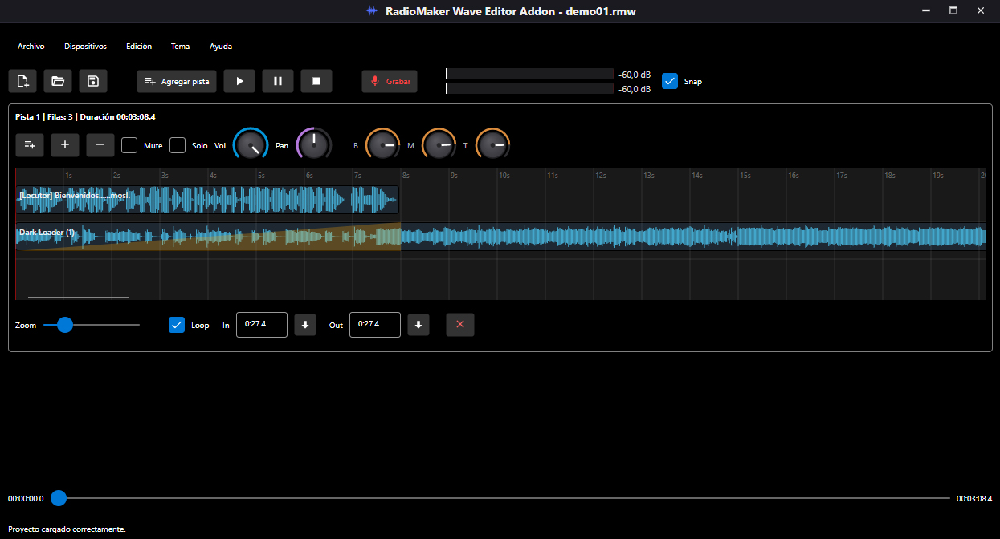

### Create a project

1. Choose **File > New** or the new-project button.
2. Add a track and place audio clips on the timeline.
3. Select a clip to edit its start, offset, duration, gain, fade-in, and fade-out.
4. Use editing commands to duplicate, split at the playhead, delete, or normalize clips.
5. Save the project as **`.rmw`**.

The project retains references to source files; do not move or delete those audio files if you want to reopen it correctly.

### Play, record, and export

- Use **Play**, **Pause**, and **Stop** on the transport bar. The space bar toggles play/pause.
- Configure the device under **Devices**.
- To record, choose **Record Audio** and select the input and destination in the dialog.
- You can add, manage, and import region markers.
- Use **Export Mix** to render the full project and **Export Selection** to render a selected range.

RMWave can create `.rmw` files for use as sources in RadioMaker. RadioMaker plays these projects with the integrated RMWave engine.

Main RMWave keyboard shortcuts:

| Shortcut | Action |
| --- | --- |
| `Ctrl+N` | New project |
| `Ctrl+O` | Open project |
| `Ctrl+S` | Save project |
| `Ctrl+E` | Export mix |
| `Ctrl+Shift+E` | Export selection |
| `Ctrl+D` | Duplicate selected clip |
| `Ctrl+B` | Split clip at playhead |
| `Ctrl+R` | Open audio recording |
| `Space` | Play or pause |
| `Delete` | Delete selected clip or range |

## 12. Emergency

Configure Emergency under **Settings > Emergency**. Set up the intended source or playlist and its options before using it on air. The Emergency button starts the configured mode; the top banner indicates that it is active and offers **Stop Emergency**.

Run a controlled test off air to verify the source, volume, and bus before relying on this feature in a real situation.

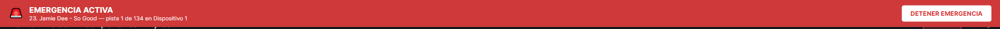

## 13. RadioMaker file formats

| Extension | Contents |
| --- | --- |
| `.rmf` | Playlist |
| `.rms` | Scheduled list |
| `.tnd` | Sequence |
| `.rme` | Chainer list |
| `.rcb` | Cart Board |
| `.rmw` | RMWave multitrack project |
| `.txt` | Plain-text note |

The playlist generator uses **`.rpg`** presets; these store generator options and are not playlists.

RadioMaker native formats store configuration and media paths. To move projects to another computer, also copy the referenced audio files or make sure they are available at the same paths.

## 14. Troubleshooting

### There is no audio

1. Check that the device is available under **Output Buses**.
2. Check the bus assigned to the module playing the audio.
3. Check global volume and the item's volume.
4. Verify that the file exists and its format is supported by the available plugins.

### A voice announcement is silent

1. Check that RMVoice is available from the panel or the **Add-ons** menu.
2. Make sure a profile is selected and its audio and tables are configured.
3. Check the location and weather data for weather announcements.
4. Test an announcement manually in RMVoice.

### A project cannot find its audio files

Projects store paths to external media. Restore the audio files to their original locations or reassign the missing files in the corresponding editor.

### Audio plays through another device

Check **Settings > Module Routing** and the tab's bus selector. Remember that Sequences and Chainers inherit routing from Scheduled playback or the playlist that plays them.

## 15. Glossary

- **Output bus:** an audio route associated with a playback device.
- **Playlist:** a sequence of tracks that can be played manually.
- **Scheduled/Scheduler:** playback automated by day and time.
- **Sequence:** a set of audio tracks played as one unit.
- **Cart:** a button that directly triggers audio.
- **Chainer:** audio inserted between playlist or Scheduled tracks.
- **Mix:** audio or a voice announcement associated with a playlist track according to its settings.
- **Fade/Crossfade:** a gradual transition between audio items.
